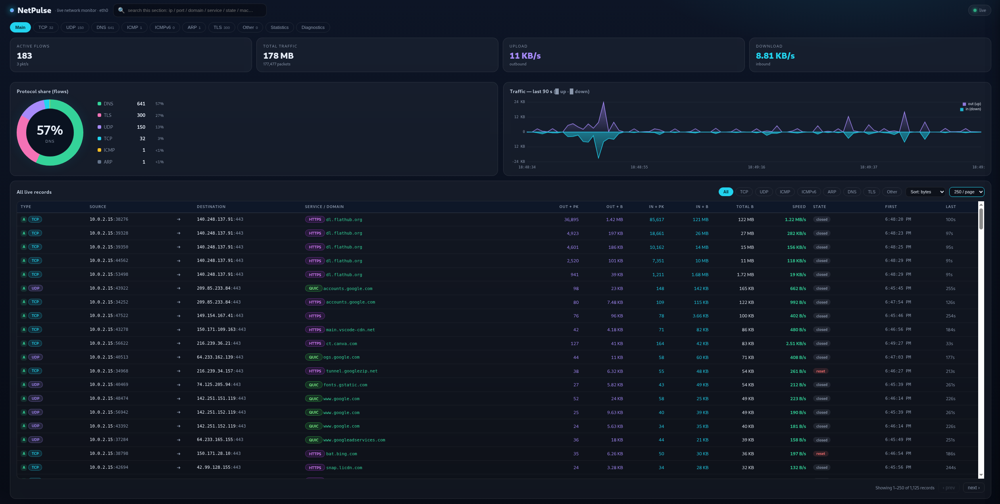

# NetPulse

A live network monitor for a single machine or VM.
**Zeek -> JSON logs -> Go bridge -> SSE -> browser dashboard.**

<p align="center"></p>

The traffic chart reads kernel interface counters. Everything else comes from
real Zeek logs. Nothing is simulated or guessed.

## What you get

| Tab | Shows |
|-----|-------|
| Main | live up/down chart, protocol share, all flows |
| TCP / UDP / ICMP / ICMPv6 | flows per protocol |
| DNS | queries, answers, response codes, round-trip time |
| TLS | SNI, version, ALPN, cipher, handshake state, **JA3 and JA4** fingerprints |
| ARP | ARP conversations with MAC addresses |
| Other | IGMP, GRE, ESP, OSPF, VRRP, PIM, SCTP and other IP protocols |
| Statistics | top endpoints, services, domains, flows by protocol |
| Diagnostics | collector state, row rates, buffer and eviction counters |

Tested on a Kali Linux VM (VirtualBox, NAT adapter, Zeek 8.x in Docker).

## Requirements

- **Linux** (Debian, Ubuntu or Kali). Zeek runs with host networking, which
  Docker supports on Linux only. macOS and Windows are not supported.
- **Docker**
- **Go 1.21 or newer**, to build the bridge
- **Git**
- `hping3` (optional), to test the Other tab

## Installation

### 1. Install the tools

```bash
sudo apt update
sudo apt install -y git golang-go docker.io
sudo systemctl enable --now docker
```

Check the versions:

```bash
git --version
docker --version
go version
```

If `go version` prints something older than 1.21 (common on older Ubuntu),
install a newer Go from https://go.dev/dl/ :

```bash
sudo rm -rf /usr/local/go
sudo tar -C /usr/local -xzf go*.linux-amd64.tar.gz
export PATH=$PATH:/usr/local/go/bin
go version
```

### 2. Let your user run Docker (optional)

Without this, put `sudo` in front of every `docker` command below.

```bash
sudo usermod -aG docker $USER
```

Log out and back in for the change to apply.

### 3. Find your network interface

```bash
ip route show default
```

The name after `dev` (for example `eth0`, `ens33` or `wlan0`) is your
interface. Use it instead of `eth0` in the Zeek command below.

## Quick start

```bash
git clone https://github.com/prohack-99/netpulse.git
cd netpulse
mkdir -p logs

# 1. Zeek collector with JA3 and JA4.
#    The first build takes several minutes (it compiles the JA4 plugin).
docker build -t netpulse-zeek:latest .
docker run -d --name netpulse-zeek   --network host --cap-add NET_ADMIN --restart unless-stopped   -w /logs -v "$PWD/zeek:/s:ro" -v "$PWD/logs:/logs"   netpulse-zeek:latest zeek -C -i eth0 /s/netpulse.zeek local

# 2. Check that Zeek is running and writing logs
docker ps | grep netpulse-zeek
ls logs

# 3. Build and start the Go bridge
go build -o netpulse main.go
./netpulse -logs ./logs -html ./index.html
```

Open http://127.0.0.1:5001 and browse a few websites to generate traffic.
Press Ctrl+C to stop the bridge. To stop Zeek:

```bash
docker rm -f netpulse-zeek
```

With Docker Compose installed, `docker compose up -d --build` replaces the
two Docker commands (set `NETPULSE_IFACE` for another interface). The compose
file is untested.

The bridge reads **new** log lines only. It never replays old history, so
start it after Zeek wrote its first logs.

## How it works

1. Zeek watches the interface and writes JSON logs (`conn`, `dns`, `ssl`,
   `arp`, `icmp_live`, `other_ip`).
2. The Go bridge tails those files, merges them into flows, and keeps all
   state in memory.
3. The browser receives a snapshot every second over Server-Sent Events.

Files:

| Path | Purpose |
|------|---------|
| `main.go` | the bridge: log tailing, aggregation, HTTP API |
| `index.html` | the whole dashboard in one file |
| `zeek/netpulse.zeek` | Zeek config: JSON logs, ICMP, ARP and other-IP-protocol logs |
| `Dockerfile` | Zeek image with the JA3 and JA4 packages |

## Bridge options

| Flag | Default | Meaning |
|------|---------|---------|
| `-logs` | `.` | folder with Zeek logs |
| `-addr` | `127.0.0.1:5001` | listen address |
| `-html` | `index.html` | dashboard file |
| `-localnets` | see `-h` | extra CIDRs counted as local |
| `-expire` | `300` | seconds before an idle flow disappears |

API: `/api/stream` (SSE), `/api/flows`, `/api/flows/<tcp|udp|icmp|icmpv6|other>`,
`/api/dns`, `/api/tls`, `/api/arp`, `/api/stats`, `/api/status`.

## Security

The dashboard has **no login**. By default it listens on `127.0.0.1` only.
Use `-addr :5001` only on a network you trust.
Zeek logs contain IP addresses, MAC addresses and visited domains.
Never publish your `logs/` folder.

## Troubleshooting

- **"collector offline"**: Zeek is not writing logs.
  Run `docker ps` and `docker logs --tail 20 netpulse-zeek`.
- **SNI, JA3 or JA4 empty**: Zeek must run with `-C` (ignore bad checksums on
  VMs). Check `tail -n1 logs/ssl.log` for `ja3` and `ja4`.
- **Other tab empty**: normal on most networks. Test it with
  `sudo hping3 --rawip -H 2 -c 3 <gateway-ip>`. Flows disappear after 5 minutes.
- **Page not reachable**: use `http://127.0.0.1:5001`, not `0.0.0.0`.
- **Statistics or a tab stays blank**: press F12, open the Console tab,
  and report the red error line.

## Known limits

- Other-protocol detection is IPv4 only.
- JA3 and JA4 need a TLS ClientHello that Zeek actually saw. Connections that
  started before Zeek show no SNI or fingerprints.
- State is in memory. Restarting the bridge clears history.

## License and credits

MIT, see `LICENSE`.

- [Zeek](https://zeek.org)
- JA3 (Salesforce) and JA4 (FoxIO) Zeek packages have their own licenses.
  Check them before you redistribute.
